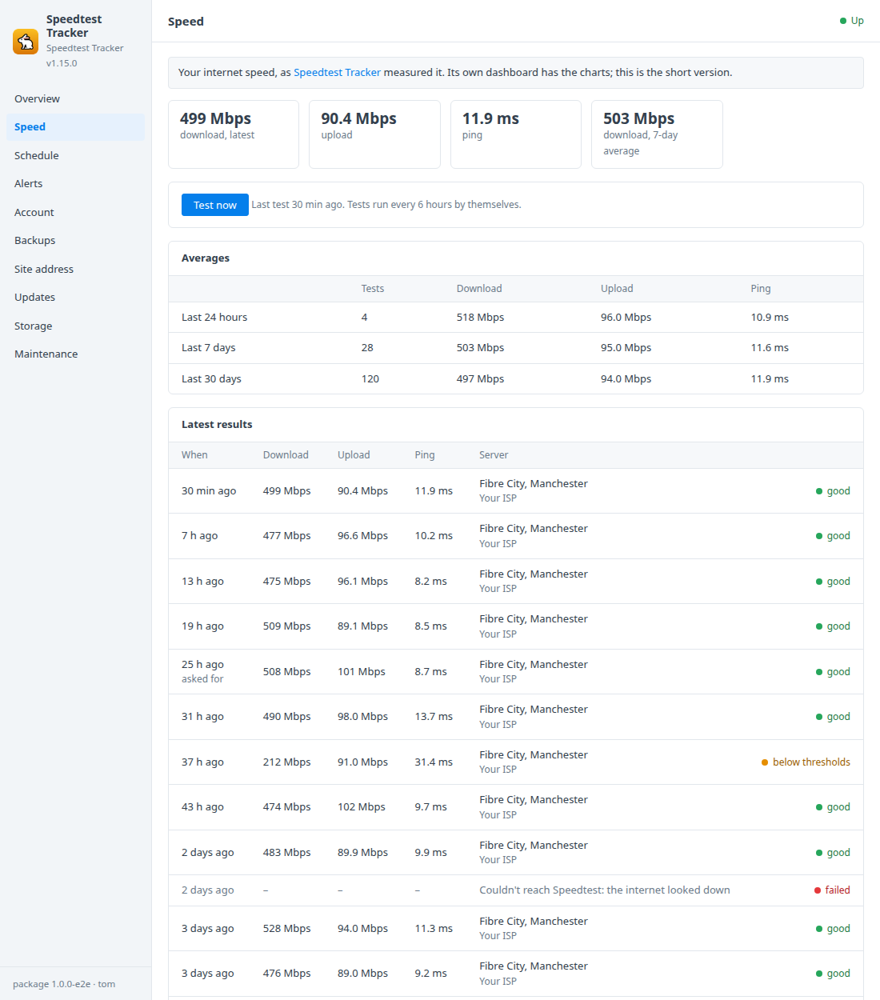
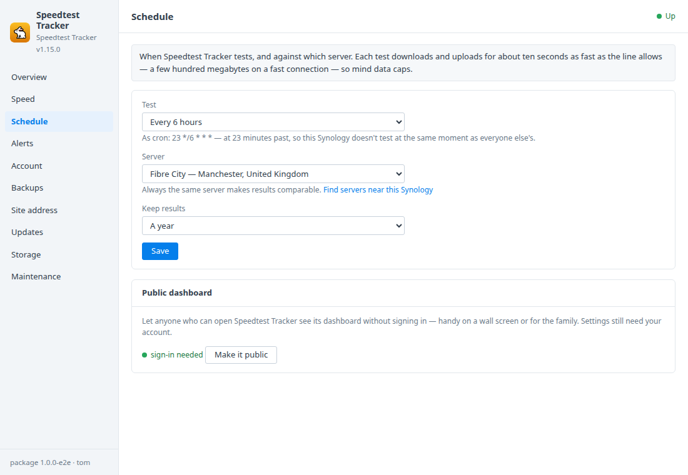
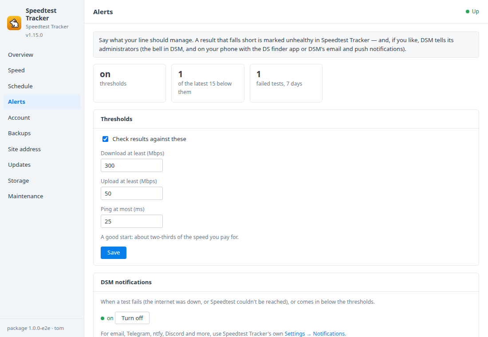
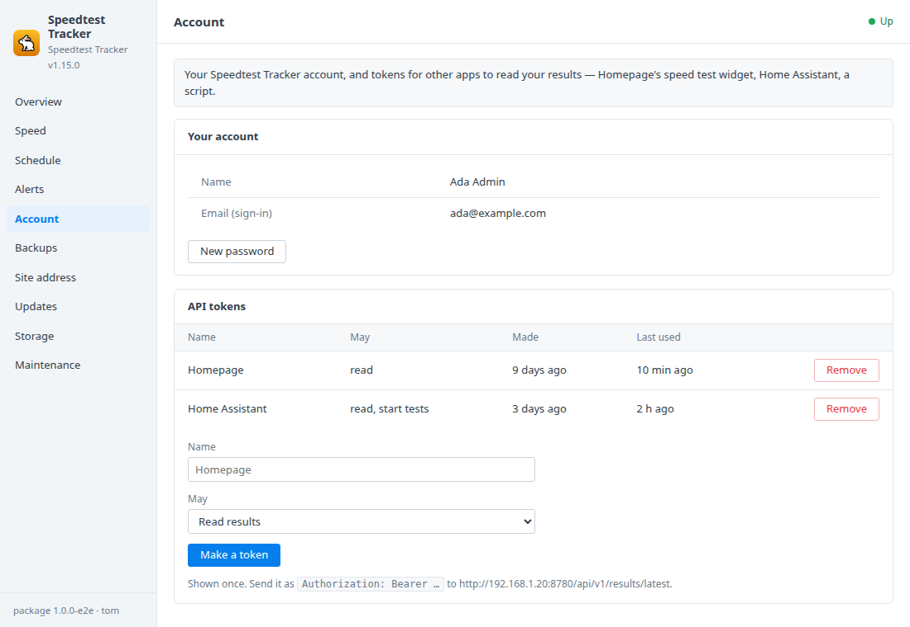

# Speedtest Tracker for Synology DSM

A DSM 7 package that installs [Speedtest Tracker](https://github.com/alexjustesen/speedtest-tracker)
in Container Manager. It tests your internet connection on a schedule
(download, upload, ping) and keeps every result, so you can see when the line
is slow and show your provider. A **Speedtest Tracker** window in DSM adds:
- the latest results and averages, and a test on demand;
- the schedule and server;
- alerts in DSM when a result falls short;
- a monthly CSV of every result in a shared folder;
- API tokens;
- HTTPS with DSM's certificate;
- backups and updates.

Built on the [DSM app chassis](https://github.com/tombruton87/dsm-app-chassis).

## Download

### **[⬇ Download speedtest.spk](https://github.com/tombruton87/speedtest-dsm/releases/latest/download/speedtest.spk)**

[](https://github.com/tombruton87/speedtest-dsm/releases/latest)

That link always gives the newest version. Older ones are on the
[Releases](https://github.com/tombruton87/speedtest-dsm/releases) page.

Install: Package Center → Manual Install → the `.spk` (DSM 7.2.1+; Container
Manager is installed first if missing). The wizard asks for:
- the NAS's address;
- a port (8780 by default);
- a time zone;
- your email and name;
- how often to test;
- HTTPS.

Speedtest Tracker ships with a well-known default login (admin@example.com /
password). The package makes it yours at the first start, with a strong
password shown once in the window.

## What the DSM window adds

- **Speed**
  - The latest download, upload and ping.
  - Averages over 24 hours, 7 days and 30 days.
  - The last 15 results with server and provider, failed tests, and those
    below your thresholds.
  - **Test now**.
- **Every result in File Station** — one CSV per month in *speedtest → Speed
  history*, updated hourly: the evidence when you ask your provider about a
  slow line.
- **Schedule**
  - Test every hour, 3 hours, 6 hours, twice a day, once a day, or only on
    request. Each install tests at its own minute past the hour, not on the
    hour like everyone else.
  - A fixed server (from a list of servers near the NAS) or the nearest.
  - How long results are kept.
  - The public dashboard, on or off.
- **Alerts**
  - Thresholds for download, upload and ping. Results that miss them are
    marked unhealthy in Speedtest Tracker.
  - A DSM notification when that happens, or when a test fails.
- **Account**
  - A new password for you, shown once.
  - API tokens for Homepage, Home Assistant or a script: read-only, or able
    to start tests. Each is shown once and can be removed.
- **Site address** — HTTPS served by the container's own nginx, with DSM's
  certificate (the system default; renewals are picked up daily) or a
  self-signed one.
- **Backups, updates, storage, maintenance** — one file holds:
  - a consistent copy of the SQLite database (every result, your account and
    settings);
  - the app key that protects them.

  Backups run nightly or on demand, with restore. You can also:
  - update to newer images or a newer package from inside DSM;
  - make a redacted support report;
  - read the logs;
  - remove Speedtest Tracker and everything with it.

Each test uses the line flat out for about twenty seconds (a few hundred
megabytes on a fast connection). Six-hourly is the default. Mind data caps
before choosing hourly.

## Screenshots

| | |
|---|---|
|  |  |
|  |  |

## How it works

Speedtest Tracker (`lscr.io/linuxserver/speedtest-tracker`) runs as one
container, with its SQLite database in the `speedtest_config` volume.

The window works through Speedtest Tracker itself. A short PHP script runs
inside its container with the app booted, passwords travelling on stdin, and
uses the app's own models and actions: results, starting a test, thresholds,
Ookla's server list and API tokens.

Some settings Speedtest Tracker reads from its environment:
- schedule;
- server;
- pruning;
- public dashboard.

The package keeps those in its own settings and recreates the container when
they change.

## Layout

```
chassis/          the DSM app chassis (git submodule)
package.conf      name, title, services, volumes, images, port, texts
app/compose.yaml  Speedtest Tracker
setup/app.sh      the hooks: your account, alerts, the CSV history, schedule, tokens, HTTPS, backups
setup/st.php      Speedtest Tracker's own models and actions, for what the window reads and changes
ui/               Speed, Schedule, Alerts and Account tabs; CGI validation (free text travels base64url)
wizard/           the Speedtest Tracker page of the install wizard
tests/            steps for the chassis harness (they run one real speed test)
```

Test: `chassis/tests/e2e.sh . up && chassis/tests/e2e.sh . act` on any Linux
box with Docker.

Release: bump `VERSION`, add the changes to `CHANGELOG.md`, build, then attach
the package twice, under its versioned name and as `speedtest.spk`:

```bash
cp dist/speedtest-X.Y.Z-1.spk /tmp/speedtest.spk
gh release create vX.Y.Z dist/speedtest-X.Y.Z-1.spk /tmp/speedtest.spk
```

Build: `chassis/build.sh . N`.

## Credits

The icon is Speedtest Tracker's own rabbit on a DSM-style tile in its amber.
Speedtest Tracker is MIT-licensed software by Alex Justesen; the image is
maintained by linuxserver.io; tests use Ookla's Speedtest CLI. This package is
not affiliated with Speedtest Tracker, linuxserver.io, Ookla or Synology.
